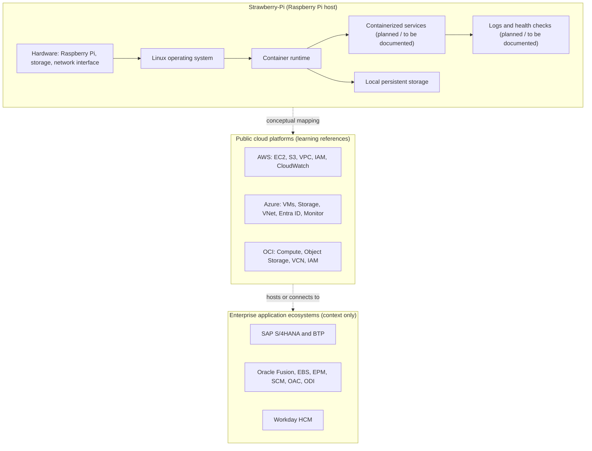

# Strawberry-Pi

> A Raspberry Pi learning platform for exploring Linux systems administration, containerized services, networking, automation, and the infrastructure concepts behind cloud and enterprise architecture.

**Status:** Conceptual and exploratory. Implementation status is not yet documented in this README. See [Current Scope and Implementation Status](#current-scope-and-implementation-status).

---

## Table of Contents

- [Overview](#overview)
- [Motivation](#motivation)
- [Project Objectives](#project-objectives)
- [Key Concepts and Areas of Exploration](#key-concepts-and-areas-of-exploration)
- [High-Level Conceptual Architecture](#high-level-conceptual-architecture)
- [Cloud Provider Ecosystem Comparison](#cloud-provider-ecosystem-comparison)
- [Enterprise Application Landscape](#enterprise-application-landscape)
- [Oracle Application Domains](#oracle-application-domains)
- [Enterprise Technology Roles and Industry Context](#enterprise-technology-roles-and-industry-context)
- [Systems Engineering Concepts](#systems-engineering-concepts)
- [Hardware and Software Context](#hardware-and-software-context)
- [Technology Landscape](#technology-landscape)
- [Engineering Principles and Design Trade-offs](#engineering-principles-and-design-trade-offs)
- [Security Considerations](#security-considerations)
- [Current Scope and Implementation Status](#current-scope-and-implementation-status)
- [Limitations](#limitations)
- [Future Roadmap](#future-roadmap)
- [Learning Outcomes](#learning-outcomes)
- [Contributing](#contributing)
- [License and Acknowledgments](#license-and-acknowledgments)

---

## Overview

Strawberry-Pi uses a Raspberry Pi as a low-cost, resource-constrained host for hands-on infrastructure learning. The aim is to build working understanding of how Linux hosts, containers, network boundaries, persistent storage, and operational tooling fit together, and how those same primitives reappear in public cloud platforms and enterprise application environments.

The Raspberry Pi is treated as an edge or homelab node, not as a substitute for production-scale cloud infrastructure. Its constraints (limited CPU and memory, SD-card or USB storage, a single network interface, and no redundancy) are part of the learning value, because they force explicit decisions about resource use, failure handling, and recovery.

## Motivation

Enterprise technology stacks are large. A cloud provider, an ERP suite, a human capital management system, and an analytics platform each represent years of accumulated design. Engineers working in these environments benefit from understanding the layers beneath the applications: compute, networking, identity, storage, integration, and observability.

Strawberry-Pi exists to make those layers tangible on hardware that can be fully understood and rebuilt. It connects infrastructure experimentation to the vocabulary and architectural patterns used by organizations that run these platforms.

## Project Objectives

- Understand how a single-board computer behaves as a server under real resource limits.
- Practice Linux system administration, including service management, users, permissions, and networking.
- Explore container-based service isolation and the boundaries between services.
- Examine how services communicate through ports, networks, and defined interfaces.
- Consider persistence, backup, and recovery for stateful workloads.
- Build habits around logging, health checks, and repeatable configuration.
- Relate local infrastructure concepts to the equivalent services in AWS, Azure, OCI, and enterprise platforms.
- Document design trade-offs, not only outcomes.

## Key Concepts and Areas of Exploration

| Area | Question the project explores |
|---|---|
| Edge computing | What can a small, low-power node reliably host, and where does it stop being useful? |
| Linux administration | How are users, services, filesystems, and network interfaces managed on a headless host? |
| Containerization | Where does isolation come from, and what does a container share with the host? |
| Service boundaries | How should responsibilities be divided between services, and what should cross the boundary? |
| Networking | How do ports, routing, DNS, and reverse proxies shape how services reach each other? |
| Persistence | Which data must survive a container restart or a rebuild, and how is it protected? |
| Configuration and secrets | How is configuration separated from code, and how are credentials kept out of version control? |
| Observability | What signals show that a service is healthy, degraded, or failed? |
| Automation | Which steps can be made repeatable, and what does that repeatability cost? |
| Security | Which privileges does each component actually need? |
| Recovery | How long does it take to return to a known-good state, and how is that verified? |

## High-Level Conceptual Architecture

The diagram below is conceptual. It shows the layers a Raspberry Pi homelab typically contains and how they relate to the cloud and enterprise ecosystems discussed in this document. The dashed relationships are learning references, not integrations. None of the cloud or enterprise products are deployed, connected to, or simulated by this project.

## Cloud Provider Ecosystem Comparison

Each provider offers a similar set of building blocks under different names. The table is intended for comparative study.

| Concept | AWS | Microsoft Azure | Oracle Cloud (OCI) | Strawberry-Pi analogue |
|---|---|---|---|---|
| Virtual compute | EC2 | Virtual Machines | Compute | Raspberry Pi host (single node) |
| Object storage | S3 | Blob Storage | Object Storage | Local filesystem or volume (no durability guarantees) |
| Virtual network | VPC | Virtual Network | VCN | Host networking and container networks |
| Identity and access | IAM | Entra ID and RBAC | IAM | Linux users, groups, and file permissions |
| Monitoring | CloudWatch | Azure Monitor | Monitoring and Logging | Logs and health checks (to be documented) |
| Containers | ECS, EKS | AKS, Container Apps | OKE | Docker or a compatible runtime (to be verified) |
| Hybrid connectivity | Site-to-Site VPN, Outposts | Azure Arc, VPN Gateway | FastConnect, Site-to-Site VPN | Not implemented |

### Amazon Web Services (AWS)

- **EC2** provides elastic virtual compute. A Raspberry Pi host is a rough analogue for one fixed-size virtual machine, without scaling, managed patching, or placement options.
- **S3** provides object storage with high durability and an HTTP API. Local storage can illustrate the object-versus-file distinction but not the durability or regional replication model.
- **VPC** provides isolated virtual networks with subnets, route tables, and security groups. Container networks and host firewall rules teach related concepts at a much smaller scale.
- **IAM** defines identities, policies, and least-privilege access. Linux users, groups, and file permissions provide a basic analogue.
- **CloudWatch** collects metrics, logs, and alarms. Local logging and health checks illustrate the same goals.

Three activities should be kept distinct: learning about an AWS service, simulating a similar concept locally, and integrating with the real service. This project concerns the first two. It does not integrate with AWS.

### Microsoft Azure

Azure offers comparable compute, storage, networking, and identity services, and is often used in enterprises alongside Microsoft's identity and productivity platforms. For this project, Azure is primarily a comparative reference. Its governance model (management groups, policy, and role-based access control) is useful for understanding how larger organizations control infrastructure at scale. Hybrid models such as Azure Arc, which extend management to on-premises machines, are relevant to edge scenarios like this one as conceptual background.

### Oracle Cloud Infrastructure (OCI)

OCI provides compute, block and object storage, virtual cloud networks, identity, and monitoring. Oracle's enterprise applications (covered below) run on or alongside OCI in many deployments, which makes OCI a useful reference for understanding how infrastructure and business applications are layered. The project does not use OCI.

## Enterprise Application Landscape

Enterprise applications sit above infrastructure. Understanding the split helps clarify what a platform team manages and what an application team manages.

| Layer | Examples | Role |
|---|---|---|
| Infrastructure | AWS, Azure, OCI, on-premises servers | Compute, storage, network, identity |
| Data and integration | Oracle Data Integrator, SAP BTP, message queues, APIs | Moves and transforms data between systems |
| Business applications | SAP S/4HANA, Oracle Fusion, Oracle EBS, Workday | Implements business processes such as finance, procurement, and HR |
| Analytics and reporting | Oracle Analytics Cloud, BI tools | Turns business data into reports and decisions |

### SAP

- **S/4HANA** is SAP's ERP suite, covering finance, procurement, inventory, sales, and production planning on an in-memory database.
- **Business Technology Platform (BTP)** provides integration, extension, and application development services that connect SAP and non-SAP systems.
- **Enterprise integration** typically uses APIs, messaging, and middleware to move business data between applications. This is the layer where infrastructure concepts such as network boundaries, authentication, and retry behavior become directly relevant.

The project does not install, emulate, or connect to SAP software.

### Workday

- **Human Capital Management (HCM)** covers worker records, organizational structure, compensation, time, and benefits.
- **Functional domains** cover business processes, configuration, security roles, and reporting.
- **Technical domains** cover integrations, data loading, report development, and extensibility.
- **Workforce data** is sensitive. Its handling raises the same access-control, auditing, and data-protection questions that appear throughout this project.

The project does not connect to Workday.

## Oracle Application Domains

Oracle's enterprise portfolio covers several distinct domains. The list below describes them for context. Strawberry-Pi does not implement any of their business functionality.

### Supply Chain Management (SCM)

- **Procurement:** supplier management, purchase requisitions, purchase orders, and sourcing.
- **Inventory:** item master data, on-hand balances, movements, and warehouse operations.
- **Order Management:** sales orders, pricing, fulfillment, and returns.
- **Planning:** demand planning, supply planning, and capacity considerations.

### Finance

- **Oracle E-Business Suite (EBS) Finance:** the general ledger, payables, receivables, and fixed assets in the on-premises EBS product line.
- **Oracle Fusion Finance:** the equivalent finance domain in Oracle's cloud application suite.

### Enterprise Performance Management (EPM)

- **Financial Consolidation and Close (FCC):** combining entity results and managing the period-end close.
- **Planning:** financial and operational planning, budgeting, and forecasting.
- **Account Reconciliation (ARC):** matching and certifying account balances.
- **Profitability and Cost Management (PCM):** allocating costs and analyzing profitability.
- **Enterprise Data Management (EDM):** governing master and reference data.

### Analytics and Integration

- **Oracle Analytics Cloud (OAC):** cloud-hosted analytics, visualization, and self-service reporting.
- **Business Intelligence (BI):** reporting and analysis as a discipline and as a tool category.
- **Oracle Data Integrator (ODI):** data integration, extraction, transformation, and loading.

## Enterprise Technology Roles and Industry Context

The table below lists role categories and experience bands from a supplied industry reference. It is included as market context.

| Role / Technology | Experience Band |
|---|---|
| Workday HCM Functional | 9–15 years |
| Workday Technical | 2–5, 5–10, 9–15 years |
| Oracle Cloud/Fusion/EBS SCM | 1–2, 2–3 years |
| Oracle Cloud/Fusion SCM — Procurement, Inventory, Order Management | 5–15 years |
| Oracle Cloud SCM Order Management | 5–10 years |
| Oracle Planning Cloud | 5–10 years |
| Oracle App/EBS/Fusion Technical | 2–5, 5–8 years |
| Oracle Analytics Cloud / BI | 2–5, 5–10 years |
| Oracle Data Integrator | 5–10 years |
| Oracle EPM — FCC, Planning, ARC, PCM, EDM | 2–5, 5–10 years |
| Oracle EBS Finance | 2–5 years |
| Oracle Fusion Finance | 2–5 years |

These ranges describe role categories in the supplied reference. They are not Strawberry-Pi requirements, personal experience claims, or guarantees of employment eligibility. The project can build infrastructure intuition relevant to these environments, but platform-specific functional and technical expertise requires separate study and hands-on practice with the vendor products.

## Systems Engineering Concepts

The following themes structure the project's learning areas. They describe what the project is designed to explore. Specific implementation status for each is documented in [Current Scope and Implementation Status](#current-scope-and-implementation-status).

**Raspberry Pi and edge computing.** A single-board computer with limited memory and I/O makes resource use visible. Edge deployments also raise questions about intermittent connectivity, power loss, and physical access that data-center environments usually abstract away.

**Linux and system administration.** The host operating system is the foundation for everything else. Relevant topics include package management, systemd services, users and permissions, storage mounts, time synchronization, and remote administration.

**Docker and containerization.** Containers provide process, filesystem, and network isolation using kernel namespaces and cgroups. They share the host kernel, which distinguishes them from virtual machines, and this shared kernel affects the security model.

**Service isolation and boundaries.** Each service should have a clear responsibility, a defined interface, and the minimum access it needs. Boundaries make failures contained and make changes easier to reason about.

**Networking, ports, and routing.** Services communicate through ports, container networks, DNS names, and reverse proxies. Understanding which services listen on which interfaces is a basic security and troubleshooting skill.

**Persistent storage and volumes.** Container filesystems are ephemeral. Data that must survive restarts or rebuilds needs an explicit volume or bind mount, along with a backup and restore plan.

**Configuration and secrets management.** Configuration should be separate from images and code. Secrets should be injected at runtime, never committed to version control, and rotated when exposed.

**Logging, monitoring, and health checks.** Logs record events, metrics describe trends, and health checks answer whether a service is currently able to do its job. Each serves a different troubleshooting purpose.

**Deployment automation and repeatability.** A deployment that can be recreated from version-controlled definitions is easier to audit, recover, and modify than one assembled by hand. Automation reduces drift but adds its own maintenance cost.

**Security principles and least privilege.** Each user, process, container, and network rule should have only the access it requires. Default-allow configurations and exposed management interfaces are common sources of risk on home servers.

**Resource constraints and performance trade-offs.** Memory, CPU, storage speed, and thermal limits determine what runs well on the Pi. Measuring before optimizing is a core habit.

**Reliability, maintainability, and recovery.** Recovery is only real if it has been tested. Backups, documented restore steps, and clear ownership of each component matter more than uptime claims.

**Hybrid-cloud and distributed systems concepts.** Hybrid architectures connect on-premises or edge systems to cloud services through VPNs, APIs, or managed agents. Distributed systems introduce partial failure, consistency trade-offs, and the need for explicit timeouts and retries. These are learning topics for this project, not current features.

## Hardware and Software Context

Specific hardware and software versions are not documented in this README. The following describes the general context.

- **Hardware:** a Raspberry Pi single-board computer, with storage on an SD card or external drive, and a wired or wireless network connection.
- **Operating system:** a Linux distribution suited to the Raspberry Pi, such as Raspberry Pi OS.
- **Software:** a container runtime and any additional tools the project depends on.

Exact models, OS versions, and software versions should be recorded when the implementation is documented, since they affect reproducibility.

## Technology Landscape

Technologies are grouped by their relationship to the project.

| Category | Technologies | Status |
|---|---|---|
| Operating system | Linux (Raspberry Pi OS or similar) | Context; version to be documented |
| Containers | Docker or a compatible runtime | Planned or in use; to be verified |
| Networking | Host networking, container networks, reverse proxy | To be documented |
| Storage | Local filesystem, volumes | To be documented |
| Monitoring | Logs, health checks, metrics | To be documented |
| Cloud references | AWS, Azure, OCI | Learning references only |
| Enterprise references | SAP, Oracle, Workday | Context only |

## Engineering Principles and Design Trade-offs

Each design choice carries a cost. The principles below guide decisions and are open to revision as the project matures.

- **Simplicity over feature count.** A small, understandable system is easier to recover and reason about than a larger one that is not fully understood.
- **Explicit over implicit.** Ports, volumes, dependencies, and configuration should be visible in the project's files rather than assumed.
- **Local learning over managed convenience.** Running a service locally exposes its moving parts. A managed cloud service removes operational burden, but it also removes the learning.
- **Constraints as a feature.** The Pi's limits force decisions about memory, storage, and failure handling that larger systems may hide.
- **Reproducibility over speed.** Repeatable setup is worth more than a quick manual fix that cannot be recreated.

Trade-offs to keep in view:

- A single node has no redundancy. Failures are simpler to diagnose but take the whole system down.
- SD-card storage is vulnerable to wear and corruption, so backups matter more than on a server with managed disks.
- Containers reduce dependency conflicts but add a layer to debug.
- Automation saves time on repeat deployments but must itself be maintained.

## Security Considerations

A home server exposed to a network is a real target. The principles below apply to this project. Their implementation status should be checked against the actual configuration before relying on them.

- **Credentials:** keep secrets out of version control and container images. Use environment injection or a secrets mechanism, and rotate any credential that has been exposed.
- **Least privilege:** run services as non-root users where possible, limit container capabilities, and grant only the file and network access each service needs.
- **Network exposure:** publish only the ports that are required. Prefer internal networks for service-to-service traffic.
- **Updates:** keep the host OS and container images updated, and track known vulnerabilities in base images.
- **Access:** protect remote administration with key-based authentication and restrict who can reach it.
- **Data:** identify which data is sensitive and limit where it is stored and how it is backed up.

Security controls described here are principles and should not be read as a claim that they are implemented.

## Current Scope and Implementation Status

This README describes the project's intent, learning objectives, and conceptual architecture. It does not yet document verified implementation details.

| Category | Status |
|---|---|
| Conceptual architecture | Described in this README |
| Enterprise and cloud landscape | Explanatory; no integrations |
| Service definitions, ports, and configuration | Not documented in this README |
| Installation and setup steps | Not documented in this README |
| Testing and validation procedures | Not documented in this README |
| Monitoring and health checks | Not documented in this README |
| Backup and recovery procedures | Not documented in this README |

Before this README is treated as a setup guide, each row above should be replaced with verified details from the implementation.

## Limitations

- The project is not a production cloud platform and makes no availability, durability, or performance guarantees.
- A single Raspberry Pi is a single point of failure.
- Storage on SD cards is less reliable than server-grade disks.
- No cloud or enterprise vendor products are integrated with the project.
- This README does not claim that any enterprise functionality is implemented.

## Future Roadmap

Planned work, listed in no particular order. Items are intentions, not commitments.

- Document the implemented architecture, including services, ports, and volumes.
- Add reproducible setup steps and configuration reference.
- Establish backup and restore procedures and test them.
- Add health checks and centralized logging.
- Evaluate a reverse proxy and defined API boundaries between services.
- Explore infrastructure-as-code approaches for repeatable deployment.
- Compare local monitoring and logging with the equivalent cloud services.
- Investigate hybrid-cloud connectivity concepts as a learning exercise.

## Learning Outcomes

Working through this project is intended to build the following understanding:

- Operating a Linux host with constrained resources.
- Isolating and connecting services with containers and networks.
- Reasoning about persistence, backup, and recovery.
- Applying least privilege and handling configuration and secrets safely.
- Mapping local infrastructure concepts to AWS, Azure, OCI, and enterprise platforms.
- Distinguishing infrastructure, integration, and business application layers.

## Contributing

Contributions that improve accuracy, clarify architecture, or document verified implementation details are welcome. Contribution guidelines, including branching, review, and testing expectations, have not yet been defined and should be added by the project owner.

## License and Acknowledgments

**License:** To be confirmed by the project owner. No license is asserted in this README.

**Acknowledgments:** Third-party software, container images, and tools used by the project should be credited here once they are confirmed.

**Trademarks:** AWS, Amazon Web Services, Microsoft, Azure, Oracle, OCI, SAP, S/4HANA, BTP, and Workday are trademarks of their respective owners. This project is not affiliated with, sponsored by, or endorsed by any of them. Product names are used descriptively to explain concepts.
